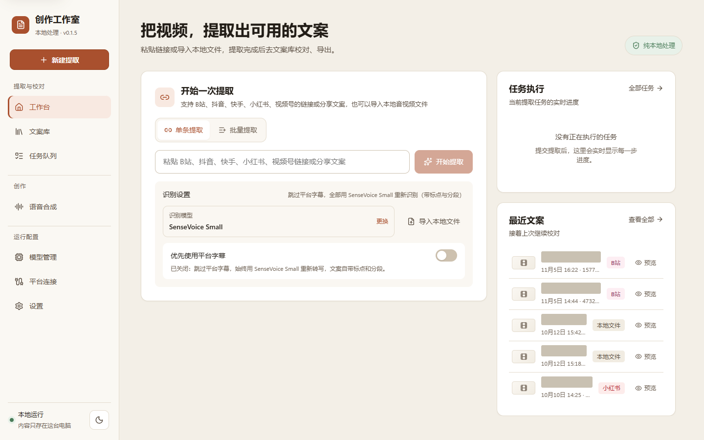
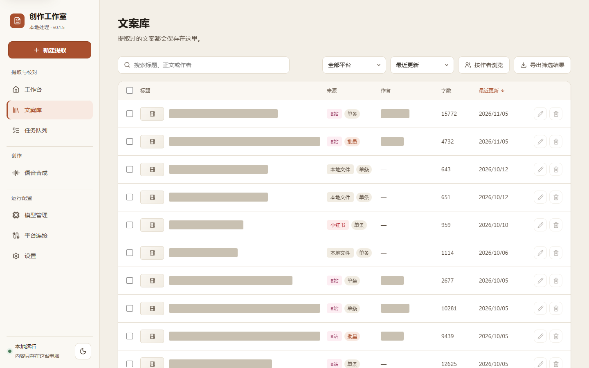
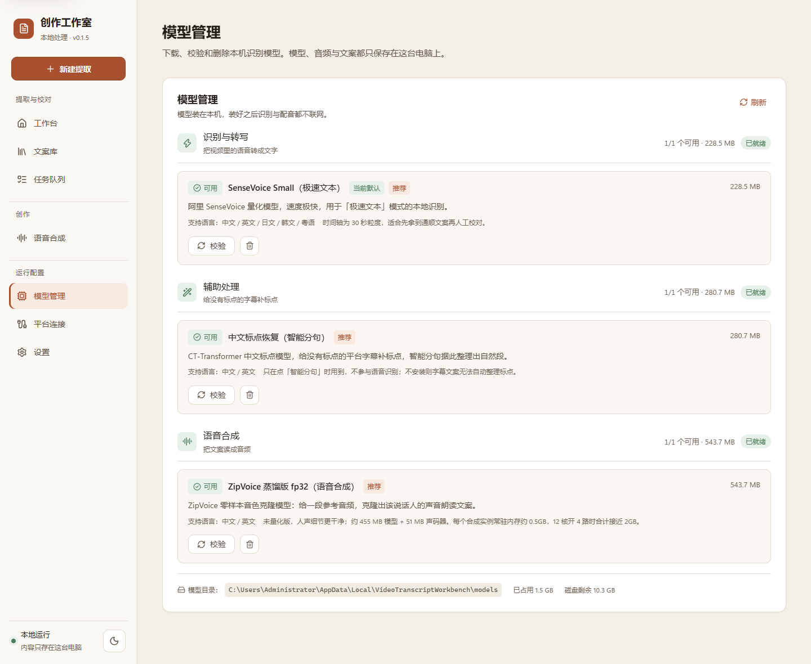
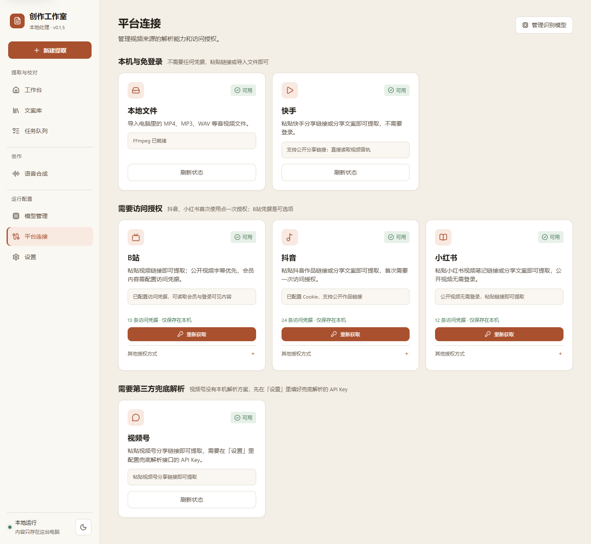
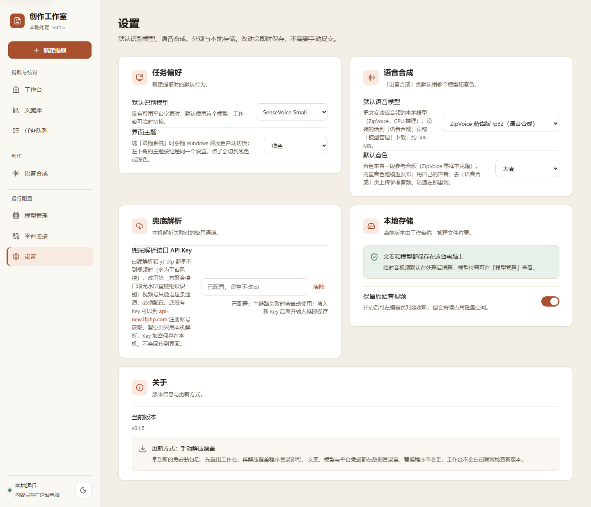

# 创作工作室

一个本地优先的 Windows 内容创作工作室。目前提供其中最成熟的一段：把视频链接或本地音视频提取成可编辑、可校对的文案（TXT / SRT / VTT / JSON 导出），音视频、Cookie 与文案全程留在本机。

> 仓库已从公开版 `splexuan/video-transcript-workbench` 迁到私有主线 **`splexuan/creator-studio`**，本仓库是这个工具唯一的开发主线；公开版不再更新。后续会往内容创作方向扩展（具体方向待定），所以仓库名只保留「工作室」这一层含义，不再把视频或文案写死。

## 下载使用

发行包由维护者直接分发（私有仓库，不提供公开的 Releases 下载）：拿到 `creator-studio-*-win64.zip` 后解压，双击目录里的 `创作工作室.exe`。

- **换新版本**：退出工作台，把新包解压后覆盖程序目录即可。文案、模型与平台凭据都放在数据目录里，覆盖程序不会丢；工作台不会自己联网检查新版本（原因见「版本与分发」）
- **免安装**：压缩包内已包含 Python 运行时与 FFmpeg，不需要另外装环境；也不需要管理员权限
- **首次使用**：到「模型管理」页下载一个语音识别模型（数百 MB 到 1 GB，取决于所选模型，仅需一次）；要提取平台视频的话，再去「平台连接」配置对应平台的登录态
- **隐私**：音视频、Cookie、文案全部留在本机，不上传任何服务器
- 运行环境：Windows 10 / 11 64 位

想从源码构建或参与开发，看下面的「开发启动」。

## 界面预览

下面按左侧导航的顺序：前两页是主流程（提取 → 校对），后三页是配置。

**工作台**：粘贴 B站、抖音、快手、小红书、视频号的链接或分享文案，也可以导入本地音视频；右侧「任务执行」实时显示每一步进度。



**文案库**：搜索标题、正文或作者，按平台与作者筛选排序，勾选后批量导出；筛选条件记在地址上，点任意一行先弹窗预览，行尾的「编辑」按钮直接进编辑页，改完返回时筛选与滚动位置都还在。



**模型管理**：本机识别模型的下载（多源断点续传）、校验与删除，并显示已占用空间与磁盘剩余。



**平台连接**：每个平台的可用状态与访问授权；抖音、小红书首次使用需要授权，B站凭据可选，快手免登录。



**设置**：默认识别模型、AI 总结用的驱动（DeepSeek 网页 / WorkBuddy / Codex）、界面主题（跟随系统 / 浅色 / 深色）、兜底解析的 API Key 与本地存储开关；所有改动**即时保存**，页头会显示「保存中 / 已自动保存」，没有提交按钮。



## 支持的能力

- 本地音视频上传、FFmpeg 音轨转换和 SenseVoice 本地识别。
- B站字幕优先：先走平台字幕接口（含未登录也能拿到的 AI 字幕），拿不到再下载音轨、用所选模型识别；配置访问凭据后还能读取会员与登录可见视频的字幕。
- 持久化单机任务队列、进度、取消和失败信息。
- 批量链接提取：一次粘贴最多 50 条链接或分享文案，提交前检查重复/不支持项；任务页把**批次**与**单条**分成两个 tab，批次可暂停、继续、取消与重试失败项。
- 文案分段校对，以及 TXT、SRT、VTT、JSON 导出。
- 提取结果一并保留来源信息：标题、作者、时长、作品介绍与封面图（封面会另存到本机，平台给的临时地址过期后仍能显示）。
- 文案库按作者与平台组织：可以「按作者浏览」（在弹窗里搜索作者，每位带篇数、总字数与时间跨度），也可以直接点列表里的作者只看他的文案；排序支持最近更新 / 最近提取 / 字数最多，搜索覆盖标题、正文、作者与作品介绍。
- 批量导出：按当前筛选（作者 / 平台 / 关键词）一次性打成一个压缩包，每篇一个 txt 文件，内容与单篇导出完全一致；重名或标题含非法字符时自动加序号、换下划线。也可以勾选若干篇只导这些：勾了导勾选的，一篇没勾就是导当前筛选的全部。
- 列表游标分页：文案库与任务队列滚到底会自动加载下一页，不必再手动点「加载更多」。
- 列表状态可回来：文案库的搜索、平台、作者与排序都记在地址上（刷新、返回、分享链接都能回到同一个列表视图），进编辑页改完再回来时筛选与滚动位置都还在；要改内容不必先开预览——列表行尾有「编辑」直达，任务队列的已完成卡片上也有「编辑文案」。
- 原始音视频默认在处理完成后清理；可在编辑页或「设置」里开启保留，保留后能在编辑页直接对照收听。
- 独立识别模型管理：多源断点续传下载、校验与删除。
- 首页直接选识别模型（SenseVoice Small / faster-whisper small / medium），并可开关「优先使用平台字幕」。
- 精准时间轴模式：faster-whisper 句级时间戳，可直接生成 SRT。
- 识别只用 CPU，不依赖 CUDA / cuDNN，装完即用、没有显卡门槛：「极速文本」把 30 秒音频块并行识别（块数随逻辑核自动伸缩），「精准时间轴」用满全部逻辑核。
- 中文转写统一输出简体：Whisper 系列常输出繁体，落库前会做一次繁转简（只映射字形，不动用词和标点）。
- 抖音链接：导入一次 Cookie 后，粘贴公开作品链接即可提取文案（抖音没有可读取的字幕，走音轨识别）。
- 小红书链接：公开视频**不需要登录**——程序用移动端 UA 读取分享页拿视频地址（桌面 UA 会被要求登录）；命中风控时自动改用本机浏览器打开页面取数据；配置 Cookie 或扫码登录还能覆盖登录可见内容。
- 快手链接：粘贴分享链接或分享文案即可提取，**不需要登录、也不需要 Cookie**——程序用移动端 UA 读取平台分享页，页面里直接内嵌视频地址。yt-dlp 没有快手 extractor、站内数据接口又带签名风控，所以这条链路走的是平台自己的分享页（详见下文说明）。
- **兜底解析**：本机解析失败时（多为平台风控），配了第三方聚合解析接口的 Key 就自动改用它取无水印直链继续识别；没配则保持原样报错，不会多发任何请求。网关地址已内置 `https://api-new.ifphp.com`，去 <https://api-new.ifphp.com/> 注册账号拿到 Key 填进「设置」即可（详见「兜底解析接口」）。
- **AI 总结**：编辑页与文案预览弹窗（工作台 / 文案库 / 任务队列共用）都有一键入口，用哪个 AI 在「设置 → AI 驱动」里选：
  - **DeepSeek（默认）**：把文案与总结指令带到 DeepSeek 网页 —— 正常情况下用 URL 参数**直接填进它的输入框**，文案过长（超 URL 长度上限）时改为复制到剪贴板并提示粘贴；总结在 DeepSeek 侧完成，本机不做任何 AI 处理。
  - **WorkBuddy / Codex（本机账号）**：复用本机客户端**已登录的账号**在本机跑完总结，不跳转浏览器。预览弹窗里摘要在正文**上方**展开（正文始终看得见，按钮兼作「收起总结」），编辑页里是独立弹窗；结果按正文缓存，收起/关掉再打开直接复用，不会重复消耗额度（想重做点「重新生成」）。驱动与模型都在「设置 → AI 驱动」里选，可用性按本机登录态自动判断（未登录的驱动会带着原因列在选项里）。模型清单取**客户端当前开放的**那些：WorkBuddy 直接读账号配置，Codex 读 Codex CLI 缓存的模型目录（CLI 每次启动会刷新一次，想立刻同步就先打开一次 Codex）。
- 视频号链接：本机没有可用的解析方案，粘贴分享链接后由兜底解析接口提取（需要先在「设置」页填好它的 API Key）；未配置时会明确提示去配置，而不是当成「暂不支持」。
- **版本**：侧边栏常驻版本号，「设置 → 关于」里也能看到；程序不联网检查新版本，换版本靠解压覆盖（见「版本与分发」）。

## 开发启动

后端需要 **Python 3.11 或 3.12**（3.13 起装不上「精准时间轴」的推理引擎，见「已知环境约束」）：

```powershell
cd backend
python -m venv .venv
.\.venv\Scripts\python -m pip install -e ".[dev]"
.\.venv\Scripts\python -m uvicorn app.main:app --reload --port 8765
```

虚拟环境固定放在 `backend\.venv`（已在 `.gitignore` 里，各人本地各建一份）；把 `backend` 当项目根，编辑器就能自动识别到它。

**不想建虚拟环境也可以**：用全局 **Python 3.11 / 3.12** 装同一套依赖，然后 `python launcher.py` 启动即可（依赖声明在 `backend\pyproject.toml`，装的时候在 `backend` 目录下执行）。`start.bat` 会按 `backend\.venv` → `backend\venv` → `PATH` 上的 `python` 依次查找解释器，所以两种方式都能双击启动；找不到解释器或解释器里缺依赖时，它会直接打印对应的安装命令，而不是只报一句启动失败。

前端（热更新，改完不用重新构建）：

```powershell
cd frontend
npm install
npm run dev
```

打开 <http://localhost:5173> 使用：Vite 开发服务器带热更新，`/api` 已代理到 `http://127.0.0.1:8765`。后端的 `--reload` 会在 `.py` 文件变化时自动重启。

想继续用后端的 `:8765`（而不是 Vite 的 `:5173`）看页面，就用监听构建：改完前端源码会自动重新产出 `frontend/dist`，刷新页面即可。它只走 esbuild、不跑类型检查，类型把关仍交给 `npm run build` 或编辑器。

```powershell
cd frontend
npm run build:watch
```

注意 `--reload` 只监听 `.py` 文件：改了 `VTW_*` 环境变量或新装了依赖，仍然需要重启进程。

依赖默认走国内镜像（`backend\pip.ini`：清华源为主，阿里、腾讯为备），无需额外配置。

> 若在受限环境（如自动化沙箱）中安装，需要先清空 `PYTHONPATH`，否则注入的 `sitecustomize.py` 会拦截 pip 的删除操作导致安装中断：
> `.\.venv\Scripts\python -m pip install -e ".[dev]"` 前先执行 `$env:PYTHONPATH=""`。

需要「精准时间轴」模式时，额外安装可选引擎：

```powershell
cd backend
.\.venv\Scripts\python -m pip install -e ".[accurate]"
```

想用「AI 驱动」里的 **WorkBuddy** 时，再装一次可选依赖（新版 WorkBuddy 客户端的登录字段是加密的，解密要用 `cryptography`）：

```powershell
cd backend
.\.venv\Scripts\python -m pip install -e ".[ai]"
```

不装也不影响其它功能：明文登录字段的客户端照常可用，只有「加密登录态」会提示这一条安装命令。**Codex** 驱动只用标准库与 `httpx`，无需额外依赖。打包时 `.[ai]` 若已安装，会一并打进产物。

前端：

```powershell
cd frontend
npm install
npm run dev
```

打开 `http://127.0.0.1:5173`。

日常使用直接双击根目录的 `start.bat`。启动器会等待本地服务就绪后自动打开浏览器；关闭启动窗口或按 `Ctrl+C` 即可停止服务。脚本先找 `backend\.venv`（兼容 `backend\venv`），都没有再用 `PATH` 上的 `python`，所以「用全局 Python 装好依赖」也能直接双击启动；`start.bat --check` 只检查环境不启动服务，出错时的等待可用 `VTW_NO_PAUSE=1` 跳过。

## 打包成 exe

**一键构建**：双击根目录的 `build.bat`，它会先让你选模式：**1** 构建前端和后端、打成发行包（完整流程，直接回车就是它），**2** 只打包发行包（用现有产物，不更新代码、不重新构建），**3** 只构建前端。完整流程会依次更新代码（`git pull --ff-only`）、构建前端、检查打包依赖、关闭正在运行的旧版本、跑 PyInstaller，最后把产物打成发行包。

命令行里可以直接指定模式，跳过选择：`build.bat all` / `build.bat frontend` / `build.bat package`（也认序号 `build.bat 1|2|3`）。自动化脚本建议直接传参数，或者设 `VTW_NO_PAUSE=1`（它同时跳过模式选择和结束时的等待，避免卡在提示上）。

构建用的解释器与 `start.bat` 是同一套查找顺序（`backend\.venv` → `backend\venv` → `PATH` 上的 `python`），脚本会把实际选中的解释器路径打出来，免得装错环境；选中的解释器里缺依赖时它会自己装一次 `.[dev,accurate,ai]`（**装进被选中的那个解释器**，回退到全局 python 就是全局环境），并提示解释器版本不是 3.11 / 3.12 的情况。

手动分步执行：

```powershell
cd frontend
npm run build
cd ..\backend
.\.venv\Scripts\python -m pip install -e ".[dev,accurate,ai]"
.\.venv\Scripts\python -m PyInstaller 创作工作室.spec --noconfirm
.\.venv\Scripts\python build_release.py
```

打包前请确认 `.[dev,accurate,ai]` 装好：`accurate` 里的 faster-whisper / ctranslate2 是「精准时间轴」的引擎，`ai` 里的 cryptography 是「AI 驱动」读 WorkBuddy 加密登录态用的。两者缺了都只是提示而非报错，容易漏看 —— 前者的提示是「产物里不会有对应能力」，后者是「WorkBuddy 加密登录态读不了」。

产物在 `backend\dist\创作工作室\`，双击其中的 `创作工作室.exe` 即可运行，整个目录拷给别人就能用（首次使用仍需下载识别模型）。

**发行包**：最后一步把上面那个目录压成可以直接上传到 Releases 的 zip，放在仓库根目录的 `release\`：

```text
release\creator-studio-v<版本>-win64.zip          （430 MB → 171 MB，约 20 秒）
release\creator-studio-v<版本>-win64.zip.sha256   （校验文件）
```

- 文件名沿用老约定：`-win64.zip` 标明平台与免安装形态，方便和别的包区分，也让历史发行包能对上；版本号从 `backend/app/config.py` 读，与界面显示的版本同一个来源。
- zip 里保留 `创作工作室/` 这一层目录，与历史发行包一致：用户解压后双击目录里的 exe 就能用，换版本时按这个结构覆盖程序目录。
- 打包脚本也可以单独用：`backend\.venv\Scripts\python build_release.py`，支持 `--level 1`（压得更快、体积略大）、`--output <目录>`、`--print-version`（只打印版本号）。
- 分发：把 zip 直接发给使用者即可。想顺手上传到私有仓库的 Releases 做备份也行（`gh release create v<版本> release\...zip --title "创作工作室 v<版本>" --notes "…"`），但工作台不再读取 Release；发版前照「版本与分发」一节确认四处版本号一致。

打包版**不会弹出终端窗口**，而是常驻**系统托盘**：

- 托盘菜单：**打开界面**（左键单击也是它）、**打开日志目录**、**退出**。关掉浏览器页面不影响服务。
- 重复双击只会把已运行实例的界面打开，不会起第二个进程、第二个托盘图标。
- 没有控制台，运行日志写在 `<数据目录>\logs\app.log`（超过 2 MB 自动留一代备份），排查问题从这里看。
- 要边看实时输出边调试，用 `创作工作室.exe --no-tray`（前台运行），或开发时跑 `python run.py --no-tray`。
- 开发用的 `start.bat` 仍是有窗口的前台模式（`launcher.py`），方便看日志与 Ctrl+C 停止。

> 在受限环境（如自动化沙箱）里打包前先清空 `PYTHONPATH`：注入的 `sitecustomize.py` 会拦截 PyInstaller 清理旧 `dist` 目录，报 `AttributeError: 'NoneType' object has no attribute 'strip'`。
> ```powershell
> $env:PYTHONPATH=""
> ```

- **自带 FFmpeg**：打包时会把 `ffmpeg.exe` 与 `ffprobe.exe` 一起打进产物，用户不需要另外安装。来源优先取 `backend\vendor\ffmpeg\`（想固定版本就放这里，该目录不入库），没有就回退到打包机 `PATH` 上的同名工具，两者都没有时打包会给出提示。
- **运行时查找顺序**：`VTW_FFMPEG_DIR` 环境变量指定的目录 → 打包资源目录 → exe 同目录 → `PATH`。所以用户也可以自己把 `ffmpeg.exe` 放到 exe 旁边或加进 `PATH`。
- **授权提醒**：随包分发 FFmpeg 前请确认其授权。gyan.dev 的 essentials 构建是 GPL；需要 LGPL 时，把 LGPL 构建的 `ffmpeg.exe`/`ffprobe.exe` 放进 `backend\vendor\ffmpeg\` 再打包即可。
- 显卡加速的 CUDA 运行库（约 1.3 GB）不打进产物，第一次用显卡时由程序按需下载。
- 应用图标在 `assets\`：`icon.svg` 是矢量源文件，`icon.ico`（打包用）与 `icon.png` 由 `python assets\build_icon.py` 导出（需要 Pillow）；前端页签用的是同一份图形的 `frontend\public\favicon.svg`，改图标时两处一起同步。

## 识别模型

模型统一安装在 `%LOCALAPPDATA%\VideoTranscriptWorkbench\models\<模型 id>`，可以在「模型管理」页下载、校验和删除。模型只能由工作台从官方与镜像源下载，不读取本机其它位置的模型文件，识别也只使用这个目录。

模型管理相关接口：`GET /api/models` 查看全部模型状态，`POST /api/models/{id}/download` 下载，`DELETE /api/models/{id}` 删除。

## 平台访问授权

抖音的凭据是**必需**的（没有它无法解析）；B站与小红书是**可选**的（公开内容不配置也能解析，配置后能读会员与登录可见内容）；**快手不需要凭据**。凭据都在「平台连接」页完成：

1. **一键获取访问权限（推荐）**：点一下，程序用本机已安装的 Chrome 或 Edge 打开平台首页，浏览器自行生成游客 Cookie，关键字段齐全会立刻保存并关闭窗口（最长等 3 分钟）。全程**无需登录、无需任何操作**。
2. **浏览器登录（可选）**：只有登录后才能观看的内容，点「用浏览器登录」，在弹出的窗口里扫码即可。
3. **手动粘贴（兜底）**：没有 Chrome/Edge 时，按 `F12` → Network → 复制请求头里的 `Cookie` 整行粘贴进来。

程序不读取浏览器的 Cookie 数据库（Chrome/Edge 127+ 已加密，且运行时被占用），而是用专用资料目录启动独立浏览器实例，通过 DevTools 协议取回凭据。该资料目录会保留，登录态与游客身份下次可直接复用。

授权信息用 Windows DPAPI 加密保存在 `%LOCALAPPDATA%\VideoTranscriptWorkbench\credentials\`，只有当前 Windows 用户能解密；接口只返回配置状态，不回传内容。任务执行时才解密到临时文件，任务结束立即删除。凭据失效时任务会给出提示，重新获取即可。B站的凭据同时作用于链接解析和站内字幕接口，因此会员视频的字幕也能读到。

平台凭据接口：`GET /api/credentials` 查看状态，`PUT /api/credentials/{platform}` 手动导入，`DELETE /api/credentials/{platform}` 清除，`POST / GET / DELETE /api/credentials/{platform}/login` 控制浏览器助手（`?mode=guest|login`）。

## 兜底解析接口

B站、抖音、快手、小红书都是**本机解析**，平台风控或页面结构变化时可能整条链路失败；**视频号没有本机解析方案，只能走这个接口**。这时如果配了第三方解析接口的 Key，工作台会改用它取直链继续识别。

**第一步：拿 Key** —— 打开 <https://api-new.ifphp.com/> 注册账号，在站内领取自己的 API Key，然后填到工作台的「设置 → 兜底解析」里。网关地址已经内置于程序（`https://api-new.ifphp.com`），**不需要配置任何环境变量**，源码运行与打包版行为一致。

要换成自己的网关时，用环境变量覆盖即可（该变量为空或只有空白时仍回落内置地址）：

```powershell
$env:VTW_FALLBACK_API_BASE = "https://你的网关地址"
```

未配置 Key 时兜底链路不参与：其它平台的行为与没有这个功能时完全一致，**视频号**则会明确提示去「设置」页填写。网关需要兼容下面这套约定（本项目按 BugPk-Api 风格的响应实现，其它同类网关只要能对上字段也能用）：

| 用途 | 路径 | 说明 |
| --- | --- | --- |
| 短视频解析聚合 | `GET /api/svparse?url=<作品链接>` | 各平台通用的聚合端点 |
| B站 | `GET /api/bilibili?url=...` | 聚合端点对 B站 可能返回 502，因此优先试专属端点 |
| 抖音 | `GET /api/dyjx?url=...` | |
| 快手 | `GET /api/ksjx?url=...` | |
| 视频号 | `GET /api/wxsph?url=...` | |

鉴权用 `X-API-Key` 请求头（也支持 `?key=` 查询参数）。工作台按平台选专属端点，失败再退回聚合端点。响应里的直链字段各端点写法不同（作者字段有 `auther`、`author.name` 两种写法，备选直链在 `video_backup[]`），程序按别名兜底取值。

**接入行为**

- Key 在「设置 → 兜底解析」里填写：与本机 Cookie 同一套 Windows DPAPI 加密保存，设置接口只回传「是否已配置」，不回传明文；输入框留空表示不改动，点「清除」才移除。
- **其它平台只在主链路失败后才使用**：没配 Key 时不发任何额外请求，错误提示与接入前完全一致。**视频号例外**，它只有这一条链路，没配 Key 时直接提示去「设置」页填写。
- 三条失败路径都会兜：解析阶段失败 → 用兜底接口的标题 / 作者 / 封面建文案，并直接下它的直链；解析成功但下载失败（风控是概率性的）→ 仍用主链路的元信息，只把音视频来源换成兜底直链；**抖音没配 Cookie**（原本直接报「需要配置凭据」）→ 也用兜底试一次。
- 兜底也没成时，任务报错会把两边的原因都带上，并保留原错误码（例如仍是 `COOKIE_REQUIRED`，便于前端继续引导配凭据）。
- 网关已内置 `https://api-new.ifphp.com`：开箱可用，源码运行与打包版都走这个地址，不需要任何环境变量；接口方换域名时用 `VTW_FALLBACK_API_BASE` 覆盖即可（该变量为空或只有空白时，仍回落内置地址）。

> 提醒：兜底网关是第三方服务，直链由对方返回、可用性不受本项目控制，使用前请自行确认合规性与稳定性；返回的直链带时效签名，只能现取现用。

## 版本与分发

版本号只有一个来源：`backend/app/config.py` 的 `app_version`（后端用它做 OpenAPI 版本与 `/api/health` 的返回值，界面显示、发行包文件名也都是它）。发版时把它和 `backend/pyproject.toml`、`frontend/package.json`、`frontend/package-lock.json` 的 `version` 一起改，**四处**保持一致：前三处是手写的，lock 里的两处由 `npm install` 自动同步（构建脚本发现 `package.json` 比 `node_modules` 新时会跑一次 `npm install`，别把这一步产生的改动漏在提交外）。

**程序不联网检查新版本**：界面只显示当前版本（侧边栏与「设置 → 关于」），没有任何更新入口，也不会向 GitHub 或别的更新服务发请求。

> 为什么去掉：项目迁到私有仓库后，未授权的 GitHub API 访问私有仓库只会拿到 404，内置的更新链路必然失效；改成带 token 又要求每台使用者的机器都配一份密钥。免安装包本来就只有「解压覆盖」这一步，人工分发更简单，也少一个会出错的网络环节。

**使用者侧的更新方式**：

1. 退出工作台（托盘菜单「退出」，或在启动窗口里 `Ctrl+C`）
2. 用新包解压出来的目录覆盖原来的程序目录
3. 重新启动 `创作工作室.exe`

文案、模型与平台凭据都在数据目录里（默认 `%LOCALAPPDATA%\VideoTranscriptWorkbench`），覆盖程序目录不会丢数据。早期版本下载过更新包的话，数据目录下会留一个 `updates\` 子目录，可以直接删掉。

## 已知环境约束

- `ctranslate2` 限定在 `>=4.4,<4.6`：更新版本在部分 Windows/CPU 环境下加载模型会触发访问违例。这条约束带来两个跟着走的限制：① 该版本只发到 `cp312`，所以后端运行在 **Python 3.11/3.12**（`requires-python` 已写上界）；② 它导入时会 `import pkg_resources`，而 setuptools 81 起不再提供，因此 `accurate` 里额外钉了 `setuptools<81`。
- 精准识别的 VAD 预处理默认关闭（依赖 `onnxruntime`，该库在同类环境下可能加载即崩溃）；设置 `VTW_WHISPER_VAD=true` 可开启，程序会先在子进程探测可用性。
- 精准识别只在 CPU 上跑，精度默认 `int8`（可用 `VTW_WHISPER_COMPUTE_TYPE` 改成 `float32` 等）。`VTW_WHISPER_BEAM_SIZE` 默认 5，设为 1 可再快约一倍（同一段音频 30 秒 → 13 秒），代价是解码质量略降。

## 原则

- 媒体、Cookie、转写文本和任务记录默认不离开本机。
- 只做「提取 → 校对 → 导出」这条链路；AI 总结交给用户自己选的 AI：DeepSeek 走网页，WorkBuddy / Codex 复用本机已登录的账号。本机不做模型推理、也不保存第三方返回的结果，但要总结就必然把文案发给所选的 AI 服务（默认是 DeepSeek）。
- 平台适配器与 ASR 引擎保持隔离，模型与引擎互不耦合，可独立替换和更新。
