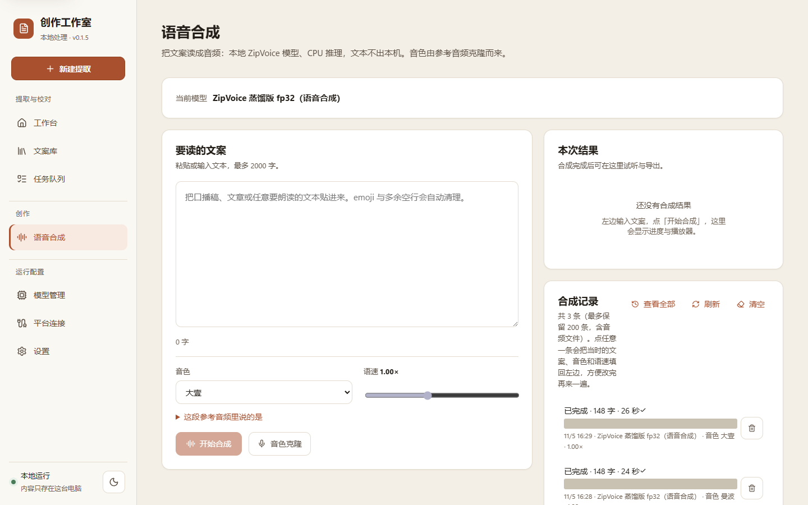

# 创作工作室

本地优先的 Windows 内容创作工作室。核心能力是把视频链接或本地音视频转换为可编辑、可校对的文案，并支持语音合成。音视频、平台凭据与文案全程保留在本机。

当前版本：`0.2.1` · 运行平台：Windows 10 / 11 64 位 · 许可证：[MIT](LICENSE)

> 本项目的前身是 v0.1.x 的「文案工作台」（旧仓库 [video-transcript-workbench](https://github.com/splexuan/video-transcript-workbench)）。v0.2.0 起改名为「创作工作室」，**数据目录保持不变**：旧版的文案、模型与平台授权会直接沿用。

## 功能概览

**文案提取**

- 支持本地音视频导入，使用 FFmpeg 转换音轨，并由 SenseVoice 在本地完成识别。
- 支持 B站、抖音、快手、小红书、视频号链接提取；B站优先读取平台字幕，无字幕时转为音频识别。
- 单机任务队列，支持进度展示、任务取消与失败信息记录。
- 批量提取最多 50 条链接或 50 个本地文件，支持暂停、继续、取消与失败重试。
- 可选「精准时间轴」模式（faster-whisper 句级时间戳），可直接生成 SRT。
- 转写结果统一输出简体中文。
- 保留标题、作者、时长、作品介绍与封面等来源信息。

**校对与导出**

- 文案分段校对与全文编辑。
- 导出 TXT、SRT、VTT、JSON。
- 文案库支持按标题、正文、作者与作品介绍搜索，按作者 / 平台筛选，按最近更新 / 最近提取 / 字数排序。
- 支持按当前筛选条件批量导出压缩包，也可仅导出勾选条目。
- 列表采用游标分页，滚动到底自动加载；搜索、筛选与排序状态保留在地址栏中。
- 原始音视频默认在任务完成后清理，可在编辑页或设置中开启保留；音轨提供可拖动、可键盘定位的波形播放器。

**语音合成**

- 基于 ZipVoice 的中英双语语音合成，输出 24 kHz 音频，支持 WAV / MP3 导出。
- 音色通过参考音频零样本克隆，可使用自己的声音；内置 3 个音色开箱可用。
- 支持参考音频裁剪、试听与自动转写，音色可重命名、删除与重新编辑。
- 语速 0.6–1.6 倍可调；长文本按 CPU 核数并行合成并支持取消。
- 合成记录保存在本机（最多 200 条），可回听、回填文案与音色、逐条删除或一键清空。

**平台与模型**

- 平台连接页统一管理各平台可用状态与访问授权，凭据使用 Windows DPAPI 加密保存。
- 模型管理支持多源断点续传下载、校验与删除，并显示磁盘占用。
- 本机解析失败时可启用第三方兜底解析接口获取直链。
- 文案可一键发送至 DeepSeek 网页进行 AI 总结，使用用户自己的账号完成，本机不保存第三方返回结果。

**技能安装**

- 把「视频文案提取」打包成独立 Agent 技能：可在页内查看说明、浏览源码并下载 ZIP。
- 页面内提供可复制的安装提示词，发给本机 Agent 即可自动下载、解压、装依赖并自检。
- 技能不依赖本程序运行，解压到 Agent 的技能目录并安装 Python 依赖即可使用。
- 下载包只含源码与说明，不含本机的 `config.json`、API Key、模型与音视频。

## 界面预览

> 截图中的文案标题、作者与合成文本已做打码处理。

| 工作台 | 文案库 |
| --- | --- |
|  |  |

| 语音合成 | 模型管理 |
| --- | --- |
|  |  |

| 平台连接 | 设置 |
| --- | --- |
|  |  |

## 快速开始

### 发行版

发行包由维护者分发。获取 `creator-studio-*-win64.zip` 后解压，双击目录中的 `创作工作室.exe` 即可运行。

- 压缩包已包含 Python 运行时与 FFmpeg，无需安装环境，也无需管理员权限。
- 首次使用需在「模型管理」页下载一个语音识别模型（数百 MB 到 1 GB，仅需一次）。
- 提取平台视频前，需按平台要求完成授权配置（快手免登录）。
- 更新版本可在「设置 → 关于与更新」里检查、下载，然后点「立即更新并重启」：程序会退出，自动备份当前程序目录、替换成新版本并重新启动；新版本启动失败会自动回滚。程序目录不可写时（例如装在 `Program Files`）会提示改用管理员身份运行或手动解压。文案、模型与凭据位于数据目录，不受程序目录变化影响。

### 从旧版（v0.1.x「文案工作台」）升级

1. 可以直接在旧版的「设置 → 关于与更新」里检查更新，也可以手动下载新版 `creator-studio-*-win64.zip`。旧版（v0.1.x）只能下载压缩包，需要手动解压；从 v0.2.1 起可以在应用内自动替换并重启。
2. 退出旧版程序，把新包解压到**新的程序目录**（不要解压进旧的 `文案工作台` 目录内部）。
3. 双击新目录里的 `创作工作室.exe`。首次启动会自动补齐数据库的新列与新表，旧文案、任务记录、模型、平台凭据都会沿用，无需重新下载或登录。
4. 确认新版可用后，旧版程序目录可以删除。程序目录名变了，桌面快捷方式需要重建。

> 数据目录默认是 `%LOCALAPPDATA%\VideoTranscriptWorkbench`，新版没有改名；这是刻意的兼容约定。

### 开发启动

环境要求：

- Python **3.11 或 3.12**（3.13 起无法安装「精准时间轴」引擎）
- Node.js 与 npm

**方式一：一键脚本**

双击仓库根目录的 `setup.bat`，脚本会创建 `backend\.venv`、写入国内镜像配置并安装依赖。该脚本可重复执行，已有虚拟环境时会跳过创建。

随后双击 `start.bat` 启动。启动器会等待本地服务就绪并自动打开浏览器；关闭窗口或按 `Ctrl+C` 停止服务。

**方式二：手动安装**

```powershell
cd backend
python -m venv .venv

# 可选：启用国内镜像（pip 仅读取虚拟环境目录下的配置）
copy pip.ini .venv\pip.ini

.\.venv\Scripts\python -m pip install -e ".[dev]"
.\.venv\Scripts\python -m uvicorn app.main:app --reload --port 8765
```

如需「精准时间轴」模式，追加安装可选依赖：

```powershell
.\.venv\Scripts\python -m pip install -e ".[accurate]"
```

前端开发：

```powershell
cd frontend
npm install
npm run dev
```

访问 <http://localhost:5173>。Vite 开发服务器支持热更新，`/api` 已代理至 `http://127.0.0.1:8765`。

也可以对前端执行监听构建，改完源码后刷新后端页面即可：

```powershell
npm run build:watch
```

> `start.bat` 按 `backend\.venv` → `backend\venv` → `PATH` 上的 `python` 顺序查找解释器，因此使用全局 Python 安装依赖后也能直接启动。`start.bat --check` 仅检查环境，不启动服务。

## 平台支持

| 平台 | 本机解析 | 访问凭据 | 说明 |
| --- | --- | --- | --- |
| 本地文件 | 是 | 不需要 | 音视频由 FFmpeg 提取音轨后识别 |
| B站 | 是 | 可选 | 优先读取平台字幕；配置凭据后可读取会员与登录可见内容 |
| 抖音 | 是 | 必需 | 通过音轨识别 |
| 快手 | 是 | 不需要 | 读取平台分享页获取视频地址 |
| 小红书 | 是 | 可选 | 公开视频免登录；命中风控时自动改用本机浏览器读取 |
| 视频号 | 否 | 兜底 Key | 通过兜底解析接口提取 |

### 平台授权

在「平台连接」页完成授权，支持三种方式：

1. **一键获取访问权限（推荐）**：程序使用本机 Chrome 或 Edge 启动独立实例，自动获取游客 Cookie，无需登录与手动操作。
2. **浏览器登录**：适用于仅登录可见的内容，在弹出的窗口中扫码登录。
3. **手动粘贴**：没有 Chrome / Edge 时，按 `F12` → Network 复制请求头中的 `Cookie` 整行粘贴。

凭据以 Windows DPAPI 加密保存在 `%LOCALAPPDATA%\VideoTranscriptWorkbench\credentials\`，仅当前 Windows 用户可解密；接口仅返回配置状态，不返回凭据内容。任务执行时凭据才解密到临时文件，任务结束后立即删除。

### 兜底解析

B站、抖音、快手、小红书均使用本机解析，视频号仅支持兜底解析。当本机解析失败或平台未提供解析方案时，若已配置第三方解析接口的 Key，程序将改用接口获取直链继续识别。

网关地址默认为 `https://api-new.ifphp.com`，可在「设置 → 兜底解析」中填写 API Key。需要更换网关时，通过环境变量覆盖：

```powershell
$env:VTW_FALLBACK_API_BASE = "https://你的网关地址"
```

接口约定：

| 用途 | 路径 |
| --- | --- |
| 短视频解析聚合 | `GET /api/svparse?url=<作品链接>` |
| B站 | `GET /api/bilibili?url=...` |
| 抖音 | `GET /api/dyjx?url=...` |
| 快手 | `GET /api/ksjx?url=...` |
| 视频号 | `GET /api/wxsph?url=...` |

鉴权使用 `X-API-Key` 请求头，也支持 `?key=` 查询参数。程序按平台选择专属端点，失败时回退到聚合端点。

> 兜底网关为第三方服务，直链可用性不受本项目控制，使用前请自行确认合规性与稳定性。接口返回的直链带时效签名，仅可即时使用。

## 识别与合成模型

模型统一安装在 `%LOCALAPPDATA%\VideoTranscriptWorkbench\models\<模型 id>`，可在「模型管理」页下载、校验与删除。程序仅使用该目录中的模型，不读取本机其他位置的模型文件。

- **识别模型**：当前界面提供 SenseVoice Small。faster-whisper small / medium 的能力保留在代码中，暂未在界面开放。
- **辅助模型**：中文标点恢复（CT-Transformer），为没有标点的平台字幕补标点与智能分段，不参与语音识别。
- **合成模型**：ZipVoice 蒸馏版 fp32（约 455 MB）及 Vocos 声码器（约 51 MB）。合成模型采用「下载归档 → 自动解压 → 必需文件校验」的安装方式；支持断点续传与声码器单独补全。
- 识别与合成均为 CPU 推理，不依赖 CUDA / cuDNN。
- 模型下载配置了多个来源，包含国内镜像与加速代理；单源过慢时会自动切换。

模型管理接口：

```text
GET    /api/models                     查看全部模型状态
GET    /api/models/tasks               查看安装进度
POST   /api/models/{id}/download       下载模型
POST   /api/models/{id}/cancel         取消下载
POST   /api/models/{id}/verify         校验模型
DELETE /api/models/{id}                删除模型
```

## 打包与发布

双击根目录的 `build.bat`，按提示选择构建模式：

| 模式 | 说明 |
| --- | --- |
| `1` / `all` | 更新代码、构建前端、检查依赖、运行 PyInstaller 并打包发行包 |
| `2` / `package` | 使用现有产物直接打包，不更新代码 |
| `3` / `frontend` | 仅构建前端 |

自动化脚本可直接传入参数，并设置 `VTW_NO_PAUSE=1` 跳过交互等待。

手动分步执行：

```powershell
cd frontend
npm run build

cd ..\backend
.\.venv\Scripts\python -m pip install -e ".[dev,accurate]"
.\.venv\Scripts\python -m PyInstaller 创作工作室.spec --noconfirm
.\.venv\Scripts\python build_release.py
```

产物位于 `backend\dist\创作工作室\`。发行包输出至仓库根目录的 `release\`：

```text
release\creator-studio-v<版本>-win64.zip
release\creator-studio-v<版本>-win64.zip.sha256
```

打包脚本也可单独调用：`backend\.venv\Scripts\python build_release.py`，支持 `--level 1`（压缩更快）、`--output <目录>` 与 `--print-version`。

打包版运行说明：

- 常驻系统托盘，无终端窗口。托盘菜单提供「打开界面」「打开日志目录」「退出」。
- 重复启动只会打开已运行实例的界面。
- 运行日志位于 `<数据目录>\logs\app.log`，超过 2 MB 自动轮转。
- 调试时可使用 `创作工作室.exe --no-tray` 前台运行。

打包细节：

- 产物自带 `ffmpeg.exe` 与 `ffprobe.exe`。查找顺序为 `VTW_FFMPEG_DIR` → 打包资源目录 → exe 同目录 → `PATH`。
- 随包分发 FFmpeg 前请确认其授权。需要 LGPL 构建时，将对应的 `ffmpeg.exe` / `ffprobe.exe` 放入 `backend\vendor\ffmpeg\` 后重新打包。
- 应用图标源文件为 `assets\icon.svg`，通过 `python assets\build_icon.py` 生成 `icon.ico` 与 `icon.png`；前端页签使用 `frontend\public\favicon.svg`。

### 版本管理

版本号以 `backend/app/config.py` 中的 `app_version` 为唯一来源，界面显示与发行包文件名均从此读取。发版时需同步修改以下位置：

- `backend/app/config.py` 的 `app_version`
- `backend/pyproject.toml` 的 `version`
- `frontend/package.json` 的 `version`
- `frontend/package-lock.json` 中的版本字段（由 `npm install` 自动同步）

程序通过 GitHub Releases 检查新版本：可以在「设置 → 关于与更新」里手动检查，也可以关闭启动时的自动检查。默认仓库为 `splexuan/video-transcript-workbench`，可用 `VTW_UPDATE_REPO` / `VTW_UPDATE_API_BASE` 覆盖。

自动更新流程（v0.2.1 起）：

1. 下载并校验发行包，解压到程序目录旁边的 `.creator-studio-update\staging`（与程序目录同一个磁盘）。
2. 启动一个 PowerShell 脚本，程序随后正常退出。
3. 脚本把当前程序目录改名为 `.creator-studio-update\backup`，把暂存目录改名为程序目录，启动新版本并轮询 `/api/health`。
4. 启动失败时删除新目录、把备份改回原名并重新启动旧版本；结果与日志写在 `.creator-studio-update\` 下，下次打开设置页会提示。
5. 程序目录不可写（`Program Files` 等）时不会提权，界面会退回「打开下载目录、手动解压」。

备份只保留一份（上一次更新前的版本），下次更新时会被覆盖。

## 配置

### 数据目录

默认数据目录为 `%LOCALAPPDATA%\VideoTranscriptWorkbench`，可通过环境变量 `VTW_DATA_DIR` 覆盖。目录内容：

```text
VideoTranscriptWorkbench\
├── workbench.db      文案库与任务记录
├── models\           识别与合成模型
├── credentials\      平台凭据（DPAPI 加密）
├── inbox\            导入的原始文件
├── work\             处理中的临时文件
├── updates\          下载好的新版本压缩包
└── logs\             打包版运行日志
```

> 目录名 `VideoTranscriptWorkbench` 为历史数据位置，长期固定，不随程序名称变更，以避免已有用户数据丢失。

### 环境变量

| 变量 | 说明 |
| --- | --- |
| `VTW_DATA_DIR` | 覆盖数据目录 |
| `VTW_MODELS_DIR` | 覆盖模型目录，默认为 `<数据目录>\models` |
| `VTW_SKILLS_DIR` | 覆盖技能包目录，默认为程序资源或仓库的 `skills\` |
| `VTW_FALLBACK_API_BASE` | 覆盖兜底解析网关地址 |
| `VTW_FFMPEG_DIR` | 指定 FFmpeg 所在目录 |
| `VTW_WHISPER_COMPUTE_TYPE` | 精准识别计算精度，默认 `int8` |
| `VTW_WHISPER_BEAM_SIZE` | 精准识别 beam size，默认 `5` |
| `VTW_WHISPER_VAD` | 设为 `true` 开启 VAD 预处理 |
| `VTW_UPDATE_API_BASE` | 版本更新 API 根地址，默认 `https://api.github.com` |
| `VTW_UPDATE_REPO` | 版本更新仓库，默认 `splexuan/video-transcript-workbench` |
| `VTW_NO_PAUSE` | 设为 `1` 时脚本出错不暂停等待 |

## API

后端基于 FastAPI，启动后可通过以下地址访问交互式文档：

- Swagger UI：<http://127.0.0.1:8765/api/docs>
- OpenAPI：<http://127.0.0.1:8765/api/openapi.json>

主要接口分组：

| 前缀 | 说明 |
| --- | --- |
| `/api/jobs` | 任务创建、查询、取消与上传 |
| `/api/job-batches` | 批量任务与批次控制 |
| `/api/documents` | 文案查询、编辑、导出与媒体文件 |
| `/api/tts` | 语音合成、音色管理与合成记录 |
| `/api/models` | 模型下载、校验与删除 |
| `/api/credentials` | 平台凭据与浏览器登录 |
| `/api/connectors` | 平台连接状态 |
| `/api/skills` | 独立技能包列表、文件预览与 ZIP 下载 |
| `/api/settings` | 应用设置 |
| `/api/updates` | 版本检查、更新包下载、自动替换与安装结果 |
| `/api/health` | 健康检查 |

## 项目结构

```text
video-transcript-workbench\
├── assets\                     图标与界面截图
├── backend\
│   ├── app\
│   │   ├── api\                HTTP 路由
│   │   ├── application\        任务、导出、平台与合成等应用逻辑
│   │   ├── domain\             领域模型与枚举
│   │   ├── infrastructure\     平台适配器、ASR/TTS 引擎、存储与数据库
│   │   ├── config.py           配置与数据目录
│   │   └── main.py             FastAPI 入口
│   ├── tests\                  后端测试
│   ├── pyproject.toml
│   └── 创作工作室.spec          PyInstaller 配置
├── frontend\                   React + TypeScript + Vite
│   └── src\
│       ├── components\         通用组件
│       ├── pages\              页面
│       └── lib\                API 客户端与工具
├── skills\                     可分发的独立 Agent 技能
│   └── video-transcript\       视频文案提取技能（自带脚本与说明）
├── build.bat                   构建与打包脚本
├── setup.bat                   开发环境准备
├── start.bat                   本地启动
└── launcher.py                 启动器
```

## 已知约束

- 后端限定 Python 3.11 / 3.12：`ctranslate2` 固定在 `>=4.4,<4.6`，该版本仅提供 `cp312` 构建；`accurate` extra 额外固定 `setuptools<81`。
- 精准识别的 VAD 预处理默认关闭（依赖 `onnxruntime`，在部分 Windows 环境可能加载失败）；设置 `VTW_WHISPER_VAD=true` 可开启，程序会先在子进程中检测可用性。
- 语音合成仅提供未量化模型，每个合成实例常驻内存约 0.5 GB。
- 识别与合成均只使用 CPU；显卡加速的 CUDA 运行库不包含在发行包中。

## 隐私说明

- 媒体、平台凭据、转写文本与任务记录默认不离开本机。
- AI 总结由 DeepSeek 网页端完成；使用该功能时文案会发送至 DeepSeek，本机不保存第三方返回结果。
- 平台适配器与 ASR / TTS 引擎保持隔离，模型与引擎可独立替换和更新。

## 许可证

[MIT](LICENSE)
